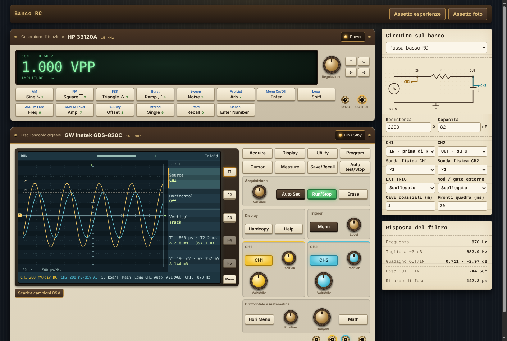

# Banco RC

Banco RC è un simulatore, che gira nel browser, del banco di laboratorio usato nelle esercitazioni di misure elettroniche. Riproduce il generatore di funzione **HP 33120A**, l'oscilloscopio digitale **GW Instek GDS-820C** e un **circuito RC** collegato ai due canali, con lo stesso pannello, gli stessi tasti e lo stesso comportamento degli strumenti veri.

**Versione online, da usare o installare come app:** https://tony-deluca.github.io/Oscilloscopio/

Il progetto è stato realizzato da **Antonio De Luca** e **Federico Boccalatte**, studenti del corso di Fondamenti di misure del prof. **Egidio De Benedetto** (Corso di Laurea in Ingegneria Informatica, A.A. 2026/2027).



## A cosa serve

Nelle due esperienze di laboratorio si impara a usare generatore e oscilloscopio:
- azzerare un canale;
- impostare frequenza e ampiezza;
- misurare ampiezza picco-picco e periodo con i cursori, con la relativa incertezza;
- capire il legame fra frequenza di campionamento, banda di Nyquist e aliasing;
- leggere uno spettro con la FFT;
- valutare i limiti degli strumenti: accoppiamento AC, banda e tempo di salita.

Banco RC permette di ripassare quei passaggi, o di vederli per la prima volta, anche fuori dal laboratorio. Non sostituisce l'esperienza al banco, che resta parte fondamentale del corso: serve a ripetere le procedure e a capire che cosa succede dentro gli strumenti.

## Come si usa

### Usarlo online

Apri **https://tony-deluca.github.io/Oscilloscopio/** in un browser. È la versione sempre aggiornata, pubblicata con GitHub Pages: ogni modifica al branch `main` arriva sul sito in un paio di minuti. Chi apre il link può usare il simulatore e installarlo, ma non modificare il progetto.

### Installarlo come app

Banco RC è una PWA, cioè un'app web installabile: ha la sua icona, si apre in una finestra propria e funziona anche senza internet.

- **Computer, Chrome:** apri il link e clicca l'icona **Installa** a destra nella barra degli indirizzi. Se non la vedi: menu ⋮ → **Trasmetti, salva e condividi → Installa pagina come app**.
- **Computer, Edge:** menu **…** → **App → Installa questo sito come app**.
- **Android, Chrome:** menu ⋮ → **Installa app** o **Aggiungi a schermata Home**.
- **iPhone, Safari:** tasto **Condividi** → **Aggiungi alla schermata Home**.

Dopo l'installazione l'app si apre dal menu Start, dal Launchpad o dalla schermata Home e funziona offline. Quando la apri con internet scarica da sola l'ultima versione; se non la vedi subito, chiudi e riapri l'app. Firefox per computer non installa le PWA: si può usare il sito, ma non installarlo.

### Senza internet e senza installazione

Scarica [`banco-rc.html`](banco-rc.html) e aprilo con un doppio clic: contiene tutto in un solo file e funziona in qualsiasi browser, anche offline, ma non diventa un'app con icona.

### Primi passi

- **Assetti.** All'apertura il banco è nell'**assetto delle esperienze**: generatore collegato direttamente a CH1, entrambi gli strumenti come appena accesi e alle impostazioni di fabbrica. Il pulsante **Assetto foto** ricostruisce invece la foto del laboratorio: passa-basso RC, 1 Vpp a 870 Hz, cursori sul segnale.
- **Manopole.** Si girano trascinandole con il mouse, con la rotella o con le frecce della tastiera dopo averle selezionate.
- **Generatore.**
  - Per inserire un valore premi **Freq**, **Ampl** o **Offset**, poi **Enter Number**, poi le cifre verdi stampate accanto ai tasti, e conferma con una freccia di unità: **↑** MHz o Vpp, **↓** kHz o Vrms, **→** Hz o dBm. Premi **Shift** prima della freccia per i millivolt.
  - **Shift + Enter** apre il menu: con ← e → scegli il gruppo (per esempio *D: SYS MENU → OUT TERM → HIGH Z*), con ↓ scendi di livello, con **Enter** confermi.
  - La tensione continua si ottiene tenendo premuto **Offset** per più di 2 secondi.
- **Oscilloscopio.**
  - Ogni tasto di menu (**Acquire**, **Cursor**, **Measure**, **CH1**, **Math**, …) mostra le sue voci accanto ai tasti **F1–F5**. La manopola **VARIABLE** regola la voce selezionata.
  - **Run/Stop** è verde mentre acquisisce e rosso quando è fermo.
  - La FFT si ottiene con **Math → F1 due volte**.
- **Pannello del banco** (a destra): circuito, resistenza e capacità, collegamenti dei canali, sonde, lunghezza dei cavi coassiali e fronti dell'onda quadra del generatore. La scheda **Risposta del filtro** mostra guadagno, fase e frequenza di taglio calcolati.

Per esempio, il primo passo delle esperienze, l'azzeramento di CH1:
1. premi **CH1** e con **F1** porta l'accoppiamento su **GND**;
2. gira **Position** finché la traccia e la targhetta «1» stanno sull'asse centrale: in basso leggi «CH1 Position 0 V»;
3. rimetti l'accoppiamento su **DC** con F1.

## Come funziona

Il comportamento degli strumenti è ricavato dai manuali ufficiali e verificato con calcoli indipendenti.

- **Strumenti.** Tasti, menu, messaggi, limiti e stati all'accensione seguono la User's Guide dell'HP 33120A e i manuali d'uso e di programmazione del GDS-800. La sintesi, con le pagine, è in [docs/manuali.md](docs/manuali.md).
- **Acquisizione dell'oscilloscopio** (`bench.js`):
  - frequenza di campionamento secondo la tabella 5-2 del manuale, fino a 100 MSa/s, e tempo equivalente sotto 250 ns/div;
  - ADC a 8 bit con 25 livelli per divisione, che satura oltre ±5,12 divisioni;
  - memoria circolare con pre-trigger e post-trigger, quindi a 100 ms/div servono 2 s per riempirla;
  - 500 punti elaborati per misure e FFT, 25 punti per divisione a schermo;
  - modi Sample, Peak Detect e Average (media mobile, più lenta ad assestarsi con più medie) e Roll.
- **Fisica del banco** (`physics.js`):
  - circuito RC caricato dagli ingressi dell'oscilloscopio (1 MΩ ∥ 22 pF) e dalle sonde;
  - cavo del generatore come linea adattata a 50 Ω, che introduce solo un ritardo; cavi verso l'oscilloscopio come capacità;
  - fronti finiti dell'onda quadra, calcolati con passi fitti vicino ai fronti, così restano nitidi anche a frequenze molto basse;
  - stadio d'ingresso con accoppiamento AC a 10 Hz e banda di 150 MHz, o 20 MHz con BW Limit.
- **Verifiche.** Il modello fisico è stato ricalcolato da zero con NumPy e SciPy, con 39 confronti su 39 in accordo ([docs/verifica-fisica.md](docs/verifica-fisica.md)). Altri 39 controlli confrontano il simulatore con i valori dei manuali.

## Limiti

- La fedeltà al firmware è parziale: i menu sono in inglese e alcune funzioni secondarie (porte, stampante, calibrazione, template FreeCapture) sono solo virtuali.
- Alcuni valori non sono dichiarati dal costruttore e sono stimati: rumore d'ingresso, numero di acquisizioni al secondo, valori del Default Setup dell'oscilloscopio, sonda ×100. L'elenco è in [docs/manuali.md](docs/manuali.md), sezione 4.
- R, C, lunghezza dei cavi e fronti della quadra sono parametri di simulazione. Le perdite dei cavi non sono simulate (meno del 3% a 15 MHz per 2 m).

## Struttura del progetto

| Percorso | Contenuto |
| --- | --- |
| `index.html`, `style.css` | Pagina e aspetto |
| `bench.js` | Pannelli, menu e motore di acquisizione dell'oscilloscopio |
| `physics.js` | Modello fisico del generatore, del circuito e dello stadio d'ingresso |
| `banco-rc.html` | Versione in un solo file, generata dai sorgenti |
| `manifest.webmanifest`, `sw.js`, `pwa.js`, `icons/` | App installabile (PWA) |
| `docs/` | Manuali riassunti, riferimenti, verifica della fisica, foto ed esportazioni di esempio |
| `tests/` | Test automatici |
| `tools/` | Generazione di `banco-rc.html` e verifica con SciPy |

## Sviluppo e test

Dopo ogni modifica a `index.html`, `style.css`, `physics.js` o `bench.js` rigenera la versione in un solo file:

```bash
node tools/build-standalone.mjs
```

Per provare la PWA in locale prima di pubblicarla, servi la cartella del progetto via http e apri http://localhost:8000/index.html; aprendo `index.html` direttamente dal disco l'app non si installa.

```bash
python3 -m http.server 8000
```

Il test del modello fisico non richiede il browser:

```bash
node tests/physics.cjs
```

Gli altri test richiedono Node.js 22.4 o successivo e un Chrome di prova avviato con `--remote-debugging-port=9238` e un `--user-data-dir` separato; un indirizzo diverso si indica con la variabile `BANCO_RC_CDP_URL`.

| Comando | Cosa verifica |
| --- | --- |
| `node tests/browser.mjs` | Il pannello completo: menu, trigger, cursori, FFT, memoria, esportazioni, versione mobile |
| `node tests/standalone-browser.mjs` | Lo stesso su `banco-rc.html`, senza file esterni |
| `node tests/conformita.mjs` | 39 controlli contro i manuali: tabella 5-2 completa, ADC, misure, FFT, cursori, trigger, sonde, limiti del generatore, robustezza |
| `node tests/fuzz.mjs [seme] [azioni]` | Azioni casuali riproducibili su tasti, manopole e campi, controllando che non compaiano eccezioni o valori non validi |

La verifica indipendente della fisica richiede Python con NumPy e SciPy:

```bash
node tools/verifica-scipy/export.cjs valori.json
```

```bash
python3 tools/verifica-scipy/verify.py valori.json
```

## Documentazione

- [Schede degli strumenti](docs/manuali.md): specifiche, tasti, menu e come il simulatore li applica.
- [Verifica della fisica con SciPy](docs/verifica-fisica.md).
- [Manuali e riferimenti](docs/riferimenti.md): fonti ufficiali usate.
- Foto del laboratorio: [display](docs/evidenze/photo-lcd.png) e [circuito](docs/evidenze/photo-rc.png).
- Schermate del simulatore: [desktop](docs/evidenze/desktop.png) e [mobile](docs/evidenze/mobile.png).
- Esempi di esportazione: [campioni CSV](docs/esportazioni/GDS-820C-campioni.csv) e [schermata PNG](docs/esportazioni/GDS-820C-display.png).
